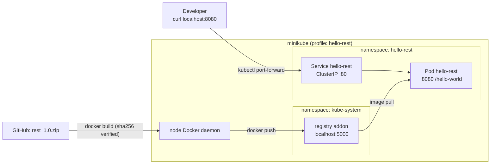

# Exercise 3 – `hello-rest` on Minikube

Runs the provided Go REST service ([`rest_1.0.zip`](https://github.com/DawiX/rest-hw-dwnld/raw/refs/heads/main/rest_1.0.zip)) on a local **minikube** cluster and makes it available at:

```
http://localhost:8080/hello-world   ->   {"message":"Hello World!"}
```

One command takes you from nothing to a running endpoint, on **Windows, macOS and Linux**.

---

## TL;DR

```bash
# Linux / macOS / WSL / Git-Bash
./scripts/dev.sh all
```

```powershell
# Windows (cmd or PowerShell) - wrapper around dev.ps1, no execution-policy changes needed
.\scripts\dev all
```

Leave that terminal open (it holds the port-forward). In a second terminal:

```bash
curl http://localhost:8080/hello-world
```

When you're done: `Ctrl+C`, then `dev down` (pause, keeps everything) or `dev destroy` (delete the cluster).

---

## Prerequisites

| Tool | Why | Install |
|------|-----|---------|
| **Docker** (Desktop or Engine) | minikube driver + `docker` CLI for building | <https://docs.docker.com/get-docker/> |
| **minikube** ≥ 1.30 | local Kubernetes cluster | <https://minikube.sigs.k8s.io/docs/start/> · `winget install Kubernetes.minikube` · `brew install minikube` |
| kubectl *(optional)* | talk to the cluster; if missing, `minikube kubectl --` is used | <https://kubernetes.io/docs/tasks/tools/> |
| curl *(bash only)* | smoke test | usually preinstalled |

Run `dev check` at any time; it reports what is missing and how to install it.

> [!NOTE]
> On Windows, PowerShell's default execution policy blocks `.ps1` files. That's why [`scripts/dev.cmd`](scripts/dev.cmd) exists: it runs `dev.ps1` with `-ExecutionPolicy Bypass` for that one process only.

---

## Commands

`dev` below means `./scripts/dev.sh` (Linux/macOS) or `.\scripts\dev` (Windows: `dev.cmd` → `dev.ps1`). Both have the same commands.

| Command | What it does |
|---------|--------------|
| `all` | `up` → `deploy` → `test` → `open` (start here) |
| `check` | Verify Docker (and that the daemon is running), minikube, kubectl, curl |
| `up` | Start minikube profile `hello-rest` (if not running) and enable the local registry. Safe to re-run. |
| `build` | Build the image and push it to the in-cluster registry |
| `deploy` | `build` + `kubectl apply -k k8s/` + wait for the rollout |
| `test` | Call `/hello-world` through a temporary port-forward and check the JSON |
| `open` | Expose `http://localhost:8080/hello-world` (blocks; `Ctrl+C` to stop) |
| `status` | Cluster status, pods, service, recent events |
| `logs` | Follow application logs |
| `undeploy` | Remove the app, keep the cluster |
| `down` | Stop the cluster. State is kept, so the next `up` is fast. |
| `destroy` | Delete the cluster completely |

Typical day: `dev up` → `dev open` … work … `Ctrl+C` → `dev down`.

---

## Configuration

All settings are in [`config.env`](config.env): cluster CPU/RAM, Kubernetes version, ports, app version, zip URL and checksum. Any value can be overridden for a single run with an environment variable:

```bash
LOCAL_PORT=9090 ./scripts/dev.sh open
```
```powershell
$env:LOCAL_PORT = 9090; .\scripts\dev.ps1 open
```

---

## How it works



1. **Image** ([`Dockerfile`](Dockerfile)). The zip only contains prebuilt binaries, no source. The build downloads it, **verifies the SHA-256**, picks `rest_1.0_linux_<arch>` for the CPU (amd64 or arm64, so Apple Silicon works too) and copies it into a `distroless/static:nonroot` image (~8 MB, no shell, non-root).
2. **Local registry.** `up` enables minikube's `registry` addon. `build` points the Docker CLI at minikube's own Docker daemon (`minikube docker-env`), builds there and pushes to `localhost:5000`, the same address the kubelet pulls from. Nothing is pushed to Docker Hub, ECR or any other remote registry, and no insecure-registry or TLS setup is needed. The scripts don't change your shell's Docker settings.
3. **Manifests** ([`k8s/`](k8s/)). Plain YAML put together with **Kustomize**, which is built into `kubectl`:
   - [`namespace.yaml`](k8s/namespace.yaml): namespace `hello-rest`.
   - [`deployment.yaml`](k8s/deployment.yaml): 1 replica, readiness/liveness probes on `/hello-world`, CPU/memory limits, hardened `securityContext` (non-root, read-only root FS, no capabilities, seccomp).
   - [`service.yaml`](k8s/service.yaml): `ClusterIP` service, port 80 → 8080.
   - [`kustomization.yaml`](k8s/kustomization.yaml): namespace, shared labels, image `localhost:5000/hello-rest:1.0`.
4. **Access from localhost.** `kubectl port-forward svc/hello-rest 8080:80` works the same on every OS and minikube driver, with no admin rights and no `minikube tunnel`.

---

## Doing it by hand (no scripts)

```bash
minikube start -p hello-rest --driver=docker --container-runtime=docker
minikube -p hello-rest addons enable registry

eval $(minikube -p hello-rest docker-env)          # PowerShell: minikube -p hello-rest docker-env --shell powershell | Invoke-Expression
docker build -t localhost:5000/hello-rest:1.0 .
docker push localhost:5000/hello-rest:1.0
eval $(minikube -p hello-rest docker-env --unset)   # PowerShell: ... docker-env --unset --shell powershell | Invoke-Expression

kubectl apply -k k8s/
kubectl -n hello-rest rollout status deploy/hello-rest
kubectl -n hello-rest port-forward svc/hello-rest 8080:80
curl http://localhost:8080/hello-world
```

To change the app, edit the files in `k8s/` and run `kubectl apply -k k8s/` (or `dev deploy`).

---

## Troubleshooting

| Symptom | Fix |
|---------|-----|
| `docker daemon is not running` | Start Docker Desktop (Win/macOS) or `sudo systemctl start docker` (Linux) |
| `Exiting due to RSRC_INSUFFICIENT_*` | Lower `MINIKUBE_CPUS` / `MINIKUBE_MEMORY` in `config.env`, or give Docker Desktop more resources |
| Port 8080 already in use | `LOCAL_PORT=9090 dev open` |
| Pod in `ImagePullBackOff` | Run `dev up` (re-enables the registry), then `dev deploy` |
| Pod in `CrashLoopBackOff` | `dev logs` and `dev status` |
| Something is weird | `dev destroy && dev all`: a clean cluster in about 2 minutes |
